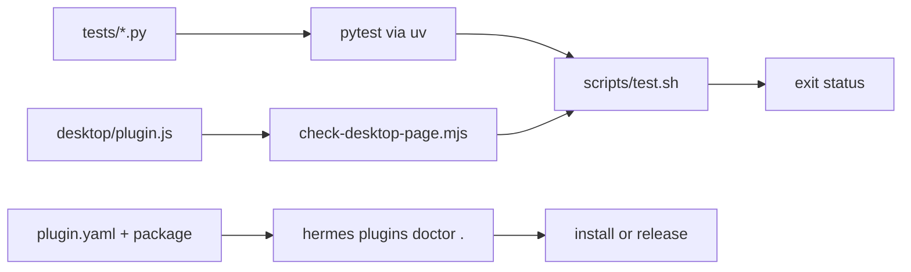

# Build, manifest and test gates

The plugin ships as source: there is no compile step, no bundler, and no package
install. `plugin.yaml` declares what the host registers, and two scripts run the
same pair of quality gates on Linux/macOS (`scripts/test.sh`) and Windows
(`scripts/test.ps1`).

## What the manifest declares

| Field | Value | Consequence |
|---|---|---|
| `name` | `coach` | Plugin id, command namespace, state directory name |
| `kind` | `standalone` | Loaded from `~/.hermes/plugins/`, enabled per profile |
| `provides_tools` | `coach_ask`, `coach_decide` | The two agent-facing tools |
| `provides_hooks` | `post_llm_call`, `pre_llm_call`, `pre_verify`, `post_tool_call`, `subagent_start`, `subagent_stop`, `on_session_end` | Active review, ambient delivery, completion gate, child tracking, pruning |
| `config_schema` | **absent** | The host adds no "Agent settings" tab; the Desktop page is the only settings surface |

`config_schema` is deliberately missing. Any schema makes Hermes render a
generic form that edits the same keys as the Coach page, and the two surfaces
then disagree. Defaults live in [configuration and state](configuration-and-state.md);
the page is the only editor.

## The two gates

| Gate | Command | What it proves |
|---|---|---|
| Python suite | `./scripts/test.sh` | 276 tests across settings, state, ledger, findings, advisor, jev, delivery, evidence, turn scoping, plugin hooks, command, dashboard API |
| Desktop page | `node scripts/check-desktop-page.mjs` | The page exports `{id, register}`, avoids context APIs the host does not provide, builds elements with `createElement`, covers every setting, registers all tabs, and renders each one against a route-aware stub |
| Host contract | `hermes plugins doctor .` | Manifest, import, registration: `2 tool(s), 7 hook(s)` |
| Live dispatch | `hermes -z '…'` | The real dispatcher accepts the tool's return shape |

`scripts/test.sh` runs both gates even when the first fails, and exits with the
first non-zero status, so a pytest failure cannot hide a page regression.
`COACH_PYTHON` overrides the interpreter (default `python3`), and
`SKIP_DESKTOP_CHECK=1` skips the node gate with a visible warning. Tests run
through `uv run --python "$PYTHON" --with <pinned deps>` — pytest, pyyaml,
fastapi and httpx at fixed versions — so results are reproducible and the
runtime environment stays untouched. `scripts/test.ps1` mirrors the same two
gates on Windows and folds both into one exit status.

## Why the page gate exists

Three failure modes only appear in the Desktop runtime, never in pytest: the
loader rejects a default export that is not `{id, register}`; the plugin context
has no `jsx`, `useValue`, `host`, or `rest.get`; and `jsx(...)` treats its third
argument as a key, so variadic children vanish. `check-desktop-page.mjs` loads
the module with stubs and fails on all three before the app sees the file.

## Related pages

- [Plugin runtime](plugin-runtime.md) — what those hooks and tools do.
- [Settings API](settings-api.md) — the backend the page talks to.
