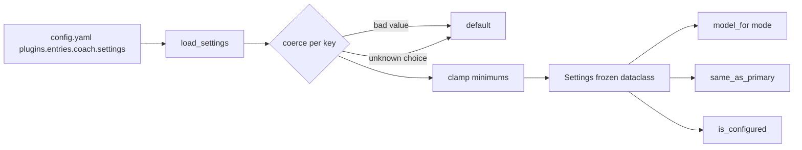
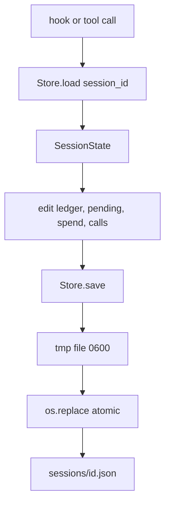

# Configuration and session state

Two modules answer different questions: `coach/settings.py` turns raw config
into a validated, immutable `Settings`; `coach/state.py` remembers what happened
in each session so reviews have continuity and spend has a ledger.

## Settings

- **33 flat snake_case keys.** Dots are reserved: the host reads a dotted key as
  a path, so `active.enabled` would nest instead of naming one setting.
- **Defaults live only here.** A checker script asserts the Desktop page has a
  control for every key, which is the drift guard that replaced the removed
  manifest schema.
- **Bad input degrades, never raises.** `_as_bool/_as_int/_as_float/_as_text/
  _as_choice` fall back per value; `_as_float` rejects NaN and infinity;
  `_as_model` requires string `provider` and `model`.
- **Minimums are applied after validation.** `ledger_max_tokens` ≥ 500,
  `max_reply_tokens` ≥ 80, call caps ≥ 1, `worker_timeout_s` ≥ 5, budgets ≥ 0.
- **`model_for(mode)`** returns the mode override or the shared model; every
  mode resolves through it, so "inherit" needs no special case.
- **`same_as_primary`** compares model *and* provider, case-insensitively. It is
  the guard that stops the coach from reviewing the primary model's own work.

## Session state

`SessionState` carries the ledger, the coach's own session note, pending advice,
per-turn call counters, holds used, spend, the last error, and `updated_at`.

`Store` is deliberately defensive:

| Behaviour | Reason |
|---|---|
| Percent-encoded file name + 8-char SHA-1 suffix | Session ids contain `/` and differ only by case on some filesystems; a lossy sanitiser made two sessions share one file |
| `os.replace` from a same-directory temp file, mode `0600` | A crash mid-write never leaves a half-parsed state |
| Corrupt file ⇒ fresh state with `last_error="state reset"` | A broken file must not break a turn |
| Unreadable file (permissions, I/O) ⇒ fresh state naming the error | The store is fail-open, but `last_error` says `state unreadable: <Error>` instead of pretending the history never existed |
| `prune()` ordered by file mtime, and sweeps stale `.*.tmp` | Content timestamps are attacker- or bug-controlled; the filesystem is not, and a crash between `mkstemp` and `os.replace` would otherwise leak files no glob sees |
| Cap of 20 sessions | Bounded disk use without a compaction pass |
| `sessions_on_disk()`/`sessions_by_recency()` skip unreadable files | Callers see the stored session id, never the encoded file stem |

`save()` also stamps `updated_at` and re-applies `0700` to an existing root,
because `mode=` only affects directory creation; a failure to do so is logged
rather than silently swallowed, and cleanup after a failed write never masks the
original error.

## Related pages

- [Prompt assembly](prompt-assembly.md) — how ledger entries become a prompt.
- [Plugin runtime](plugin-runtime.md) — who calls `load`/`save`, and when.

## `coach/state.json`

`{"seen_cwds": [...]}` records the working directories the plugin has seen, so
the dashboard can allow project-scope guidance for them. Written once per
directory per process, 0600, capped at 20 entries.

## Secrets

`decide_typesafe_api_key` is read from `.env` only. `/coach set` refuses it and
the dashboard rejects the key by name, so no route writes a credential to
`config.yaml`.

## Log names

`logs/<state-safe-name>.jsonl`, the same percent-encoded-plus-hash encoding as
session files; sanitising unsafe characters to `_` made `task/1` and `task_1`
share a log.
