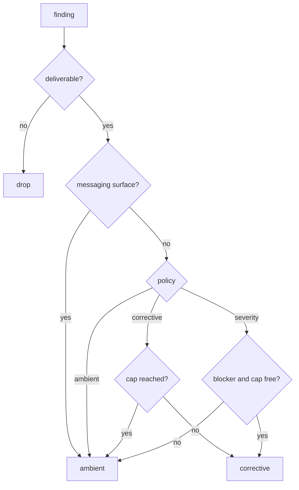
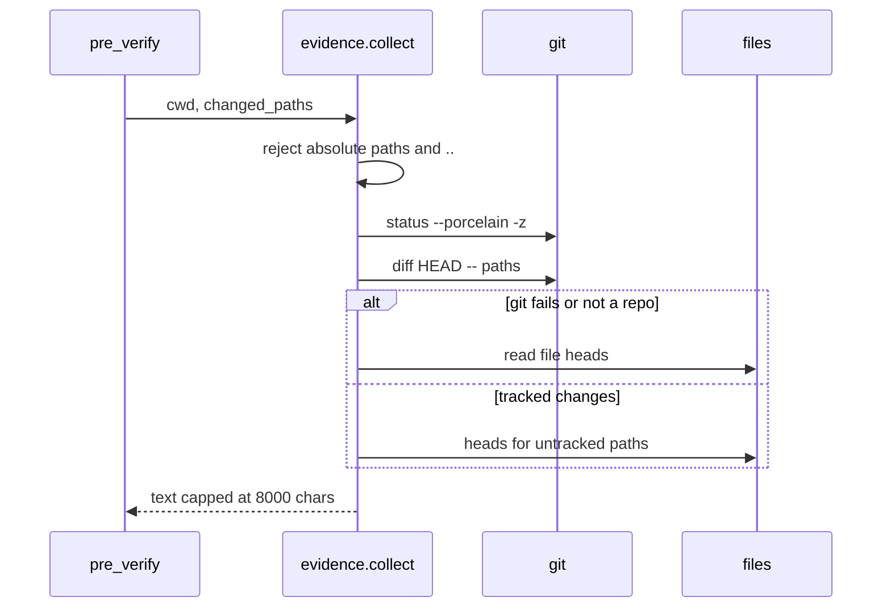

# Delivery and evidence

`delivery.py` decides where a finding goes; `evidence.py` decides what the
completion review is allowed to see. Both are boundaries: one between the coach
and the conversation, one between the repository and the model.

## Routing a finding

| Route | Mechanism | Cost |
|---|---|---|
| `ambient` | Card now; the note is stored and returned by the next `pre_llm_call` as context | The review only; no extra model call |
| `corrective` | A message in the conversation, which starts a turn | A full turn, often with tools |
| `drop` | Nothing delivered | — |

Messaging surfaces (Telegram, Discord, …) always take `ambient`: an injected
turn there has no live agent to act on it. The corrective cap
(`delivery_max_corrective_per_request`) is counted per user request, so advice
cannot turn into a conversation of its own.

The formatters wrap model text in tags (`<coach-note>`) and escape the closing
tag inside it, so a finding cannot end its own block and become an instruction.
Attributes go through a separate escaper; text nodes only need the tag strip.

## Evidence for the completion review

- `git status -z` with `core.quotePath=false` keeps paths verbatim: no C-style
  octal escaping for spaces or non-ASCII names.
- `git diff HEAD` covers staged and unstaged edits together; a plain `git diff`
  would miss newly created files, which are the highest-risk edits.
- Untracked paths are appended as `(new file)` heads so they are reviewed too.
- Paths are project-relative and resolved under the session cwd; absolute paths
  and any `..` component are refused.
- The runner is injected, so tests exercise every branch without a real repo.
  Each git call has a 5 s timeout and `shell=False`.

## Related pages

- [Prompt assembly](prompt-assembly.md) — how a delivered note is worded.
- [Plugin runtime](plugin-runtime.md) — who calls `route()` and when the hook fires.
