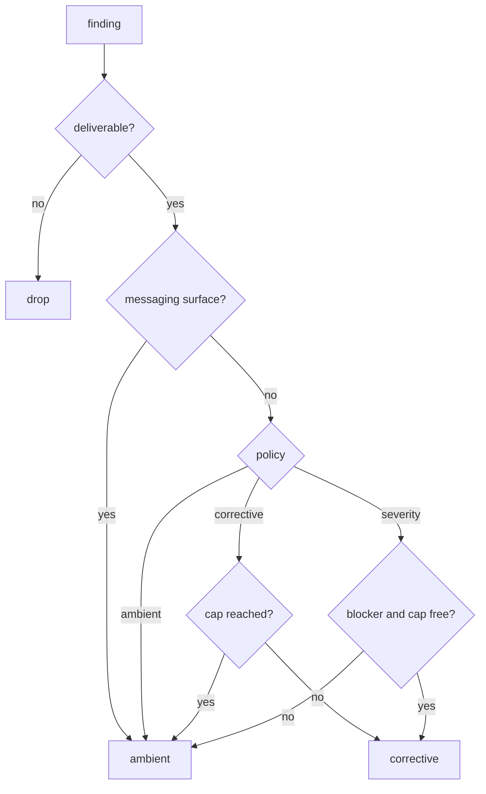
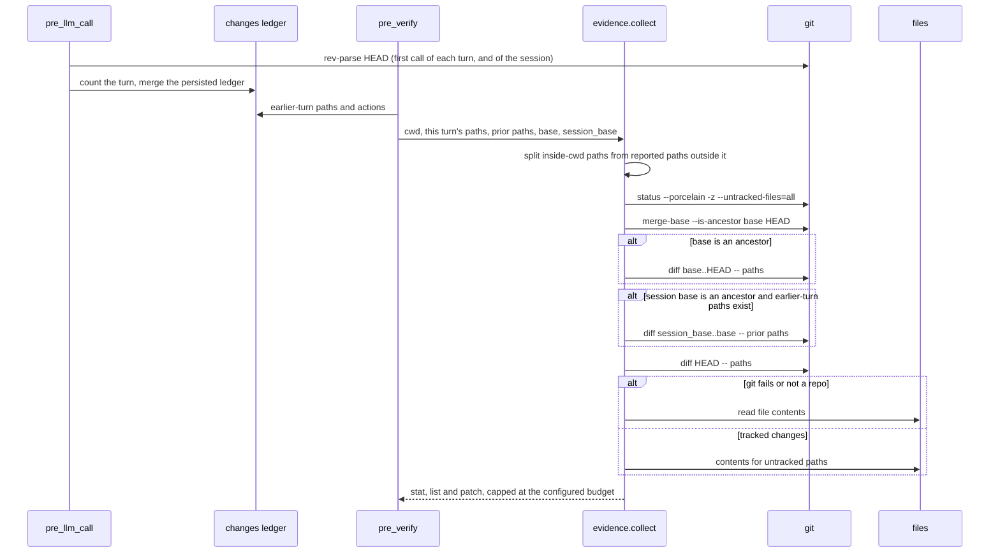

# Delivery and evidence

`delivery.py` decides where a finding goes; `evidence.py` decides what the
completion review is allowed to see. Both are boundaries: one between the coach
and the conversation, one between the repository and the model.

## Routing a finding



| Route | Mechanism | Cost |
|---|---|---|
| `ambient` | Card now; the note is stored and returned by the next `pre_llm_call` as context | The review only; no extra model call |
| `corrective` | A message in the conversation, which starts a turn | A full turn, often with tools |
| `drop` | Nothing delivered | — |

`unverifiable` is routed to `ambient` before the policy is consulted: an
incomplete evidence block must never hold a completion or start a turn.

The evidence bundle is assembled so a clipped patch cannot be mistaken for the
whole change set:

```
--- stat (commits since turn start (<base>..HEAD)) ---
--- files changed (<N>) ---          # git diff --name-status, plus ?? untracked
--- coverage ---                     # counts, patch budget, truncation notice
--- committed during this turn ---   # patch, clipped to the budget
--- uncommitted ---
--- new files ---                    # bounded heads, [file truncated] markers
```

The header survives truncation; only the patch is clipped, and the coverage
line says so. Every git call runs with `-c core.fsmonitor=false` so a
repository's own config cannot execute code inside the gate.

The completion gate hands its finding to `deliver()` too, with
`allow_corrective=False`: the gate has its own single-hold authority, so
delivery policy must not open a second, uncapped turn from there. A held
blocker is carded and returned as a self-contained message (title, body,
evidence, fix) inside the current turn; every other finding is carded and
queued as a note the agent reads at the start of its next turn. Before this,
a review finding was only a card, so the model never learned about it.

Notes are deduplicated per `(turn, title)`: Active and the gate can flag the
same turn, and the model should read it once. Every card respects
`delivery_show_cards`, which makes the coach visible without changing what the
model sees.

Messaging surfaces (Telegram, Discord, …) always take `ambient`: an injected
turn there has no live agent to act on it. The corrective cap
(`delivery_max_corrective_per_request`) is counted per user request, so advice
cannot turn into a conversation of its own.

The formatters wrap model text in tags (`<coach-note>`) and strip both the
opening and closing tag from every model-supplied field, case-insensitively and
tolerating inner whitespace, so a finding cannot end its block (or open a
spoofed one) and become an instruction.

## Evidence for the completion review



The review covers the whole **session**, not only the current turn and not
only what is still uncommitted. The plugin records `HEAD` on the first
`pre_llm_call` of a turn (and of the session), so an agent that commits before
claiming completion is still reviewable, and commits made in earlier turns are
diffed with `session_base..base`. When a range is unusable (rebase, amended
history, no recorded base) the block says `not an ancestor of HEAD` and falls
back to the worktree.

`coach/changes.py` is the session ledger. The host reports only the current
turn's changed paths, so the plugin records every `write_file`/`patch` path it
sees (`post_tool_call`) plus the actions that leave no diff — `memory`,
`skill_manage`, cron — each tagged with the coach's own turn counter. Paths
are stored absolute, merged from the persisted state after a reload, and capped
at 500 per session; the reviewer receives the earlier-turn paths labelled as
such.

- `git status -z --untracked-files=all` keeps paths verbatim and lists new
  files individually, instead of collapsing a new directory into a `dir/` entry
  that the diff never matches.
- `git diff <base>..HEAD` carries the commits the turn produced; `git diff HEAD`
  adds edits not yet committed. Both pass `--no-color`, `--no-ext-diff` and
  `--no-textconv`, so repository config cannot colour the patch, invoke an
  external diff, or run a textconv driver.
- Untracked paths are appended as `(new file)` heads so they are reviewed too.
- Paths under the session cwd are project-relative and contained; `_heads` and
  `_outside_text` re-resolve each read so a symlink swap cannot redirect it. A
  reported absolute path **outside** cwd is read as content, never diffed, and
  the block says so — dropping it made a claimed skill or notes edit look
  missing.
- A `--stat` line leads the block. Over budget, the file list and coverage line
  survive and the patch is clipped **by name**: the note lists the files it did
  not show (the file straddling the cut included), never a bare
  `[patch truncated]`.
- Every cap either fits the configured budget or declares its overflow: the
  file list clips itself with a counted row, the path cap names examples, the
  contents budget reports a file's real size, and an exhausted git budget says
  so instead of reading as "nothing changed".
- The runner is injected, so tests exercise every branch without a real repo.
  Each git call has a 2 s timeout inside an 8 s total budget, and `shell=False`.

## Related pages

- [Prompt assembly](prompt-assembly.md) — how a delivered note is worded.
- [Plugin runtime](plugin-runtime.md) — who calls `route()` and when the hook fires.
