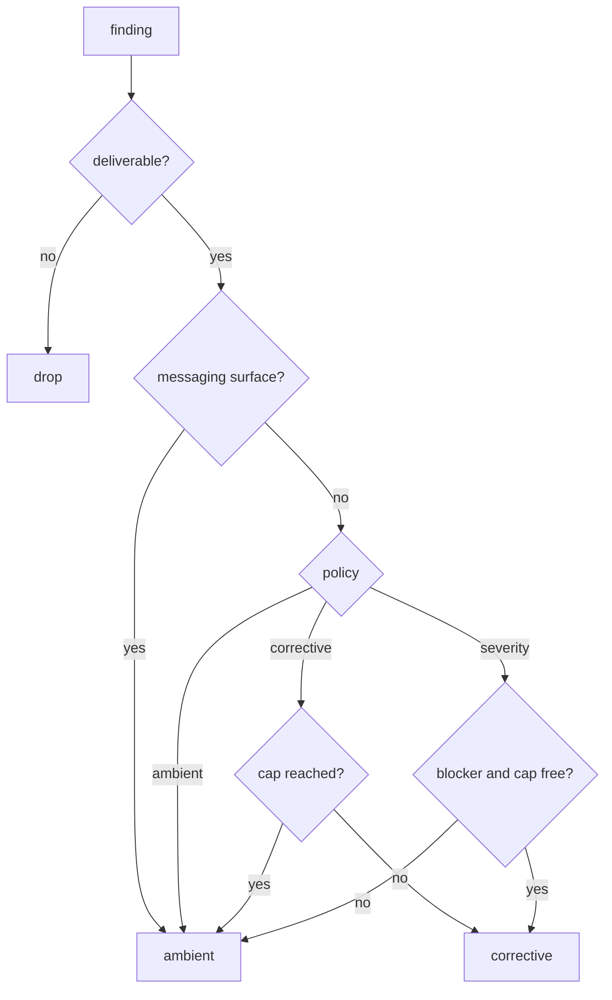
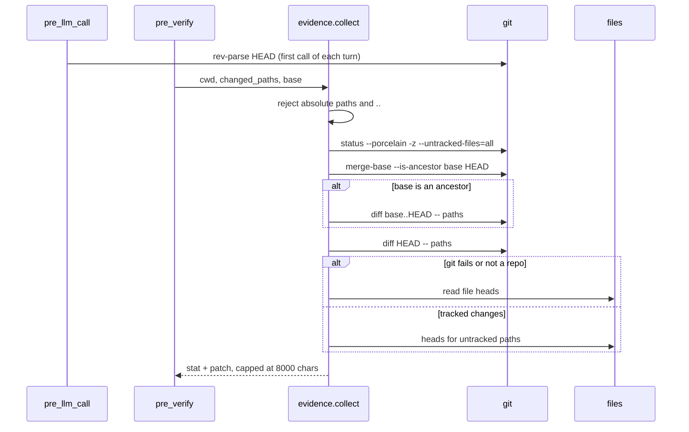

# Delivery and evidence

`delivery.py` decides where a finding goes; `evidence.py` decides what the
completion review is allowed to see. Both are boundaries: one between the coach
and the conversation, one between the repository and the model.

## Routing a finding

| Route | Mechanism | Cost |
|---|---|---|
| `ambient` | Card now; the note is stored and returned by the next `pre_llm_call` as context | The review only; no extra model call |
| `corrective` | A message in the conversation, which starts a turn | A full turn, often with tools |
| `drop` | Nothing delivered | — |

Messaging surfaces (Telegram, Discord, …) always take `ambient`: an injected
turn there has no live agent to act on it. The corrective cap
(`delivery_max_corrective_per_request`) is counted per user request, so advice
cannot turn into a conversation of its own.

The formatters wrap model text in tags (`<coach-note>`) and strip both the
opening and closing tag from every model-supplied field, case-insensitively and
tolerating inner whitespace, so a finding cannot end its block (or open a
spoofed one) and become an instruction.

## Evidence for the completion review

The review covers the whole turn, not only what is still uncommitted. The
plugin records `HEAD` on the first `pre_llm_call` of a turn, so an agent that
commits before claiming completion is still reviewable. When the range is
unusable (rebase, amended history, no recorded base) the block says
`not an ancestor of HEAD` and falls back to the worktree.

- `git status -z --untracked-files=all` keeps paths verbatim and lists new
  files individually, instead of collapsing a new directory into a `dir/` entry
  that the diff never matches.
- `git diff <base>..HEAD` carries the commits the turn produced; `git diff HEAD`
  adds edits not yet committed. Both pass `--no-color`, `--no-ext-diff` and
  `--no-textconv`, so repository config cannot colour the patch, invoke an
  external diff, or run a textconv driver.
- Untracked paths are appended as `(new file)` heads so they are reviewed too.
- Paths are project-relative and resolved under the session cwd; absolute paths
  and any `..` component are refused, and `_heads` re-resolves each read so a
  symlink swap cannot redirect it.
- A `--stat` line leads the block. Over budget, the file list survives and the
  patch is clipped with `[diff truncated]`, so neither half is traded away.
- The runner is injected, so tests exercise every branch without a real repo.
  Each git call has a 5 s timeout and `shell=False`.

## Related pages

- [Prompt assembly](prompt-assembly.md) — how a delivered note is worded.
- [Plugin runtime](plugin-runtime.md) — who calls `route()` and when the hook fires.
