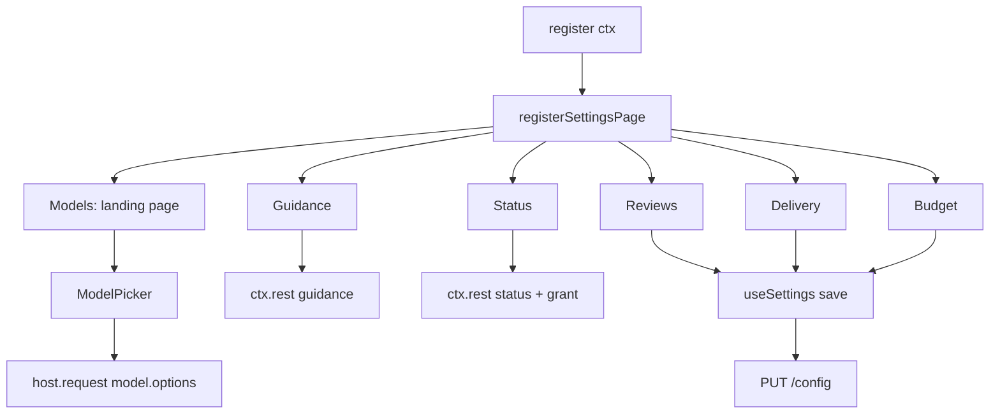

# Desktop settings page

`desktop/plugin.js` is the plugin's entire GUI: a single plain-ESM module the
Desktop shell hot-reloads. It has no build step and no dependencies beyond React
and the plugin SDK.

## Component tree

| Piece | Responsibility |
|---|---|
| `page(Component)` | Wraps every tab: creates one `useSettings`, reads the main model, renders a loading or error state |
| `useSettings` | Fetches `/config` and `/status`; serialises saves **and reloads** through one promise chain, so a reload cannot overwrite a fresher save; ignores late responses after unmount |
| `ModelPicker` | Search field over a provider-grouped list; "Inherit shared model" on overrides; bounded height so it scrolls instead of clipping |
| `Card`, `Field`, `Toggle`, `Choice`, `NumberField`, `TextField` | The whole control vocabulary; each renders a label, a control, and its explanation |
| Page components | One per tab, each explaining its mode before showing controls |

## Data rules the page follows

- Build elements with `createElement`. `jsx(...)` takes children from props, so
  a variadic call drops every child and passes the first one as a key.
- Use `host`, `useValue`, and `ctx.rest(path, {method, body})`. The page context
  has no `jsx`, `useValue`, `host`, or `rest.get`; the checker fails on those.
- Save one key per PUT and let the response replace local state, so the page
  never guesses what the backend stored.
- A guidance save captures scope, cwd and text when it starts: switching tabs
  mid-save reports "saved, the editor moved on" instead of writing one file and
  reporting on another.
- Number and text fields sync their draft to the clamped or trimmed value, so
  the control shows what was kept before the round-trip lands.
- The main-model warning splits `provider/model` on the **last** slash; model
  ids contain slashes, and splitting on the first silently defeats the
  same-model warning.
- A failed `/recent` fetch says so instead of rendering an empty list, so
  "no reviews" always means no reviews.
- Keep the picker's provider grouping: rows carry `slug` and `name`, models are
  strings, and a flat list loses which provider a model belongs to.

## Development loop

Because the plugin is installed as a symlink, saving this file re-syncs the
Desktop copy and hot-reloads the page. `node scripts/check-desktop-page.mjs`
runs the same checks in CI-ish form: default export shape, forbidden context
APIs (comment- and string-aware, including optional chaining and bracket
access), `createElement`, every setting covered, all tabs registered, and a deep
render of each tab against a route-aware `ctx.rest` stub.

## Related pages

- [Settings API](settings-api.md) — the endpoints behind every control.
- [Build, manifest and test gates](build-and-test.md) — the page check in context.
