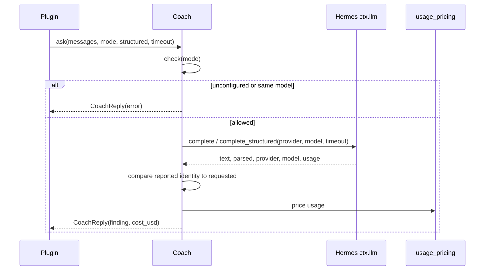
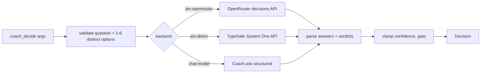

# Model access: coach client and decisions

`coach/advisor.py` makes every chat call; `coach/jev.py` makes typed decisions.
Both are fail-open: a failure returns a result object with an error, never an
exception that could reach a turn.

## The coach client

| Guard | Behaviour |
|---|---|
| `check(mode)` | `unconfigured` with no shared model; `same_model` when the resolved pair equals the primary (unless `skip_same_model` is off) |
| Provider failure | `provider_error: <ExceptionType>`; the turn continues |
| Model resolution | An auto-router id or host fallback answers as a concrete model; the reply is accepted, attributed and priced as the served model — exact equality with the requested pair is not required |
| Pricing | Injected `cost_fn` in tests; otherwise `agent.usage_pricing.estimate_usage_cost`, guarded to `0.0` |
| Deadline | Caller-supplied: 45 s for Active/Consult, 20 s under the Review hook (the host bounds hooks at 30 s) |

The reply always names the model that served it (`provider`, `model`), and the
cost follows that model. An auto-router such as `kilo-auto/free` never reports
its own id, so equality is the wrong check.

## Decisions

- Endpoints: `https://openrouter.ai/api/alpha/decisions` and
  `https://api.typesafe.ai/v1/systemone`, JSON POST with a 15 s timeout.
- API keys never come from the process environment directly: `tool_decide`
  resolves them through `coach/secrets.py`, which prefers the host's
  profile-scoped secret scope (`agent.secret_scope.get_secret`) and falls
  back to the process env only on hosts predating that seam. An explicit
  `decide_typesafe_api_key` setting still wins for the direct backend.
- Confidence is clamped to 0–1; NaN or infinity becomes the default.
- An unknown or missing `gate` becomes **`escalate`**, never `act`: the
  tiebreaker withholds action unless it is sure.
- A choice below `decide_min_confidence` also escalates, even if the model said
  `act`.
- Every failure path returns `gate="error"` with a one-line reason, including a
  malformed response body and an empty API key. A single string passed as
  `options`, a non-iterable, an absent `base_url`, or a state mapping that cannot
  be serialised (a cycle) degrades to an error decision instead of raising.
- The chat-model backend needs a `parsed` mapping from the call; prose, a
  malformed choice, or a missing client is an error decision too.

## Related pages

- [Prompt assembly](prompt-assembly.md) — the messages both clients receive.
- [Plugin runtime](plugin-runtime.md) — budget, call caps, and who invokes them.

## Reasoning level

Each mode has a reasoning level alongside its model: `reasoning_effort` is the
shared default and `active_reasoning` / `review_reasoning` / `consult_reasoning`
override it per mode; an empty value inherits the app's level. The page renders
the same scale and labels as the main model picker (off, minimal, low, medium,
high, xhigh, max, ultra).

Delivery needs the host: `ctx.llm.complete*` accepts `reasoning_effort` and
forwards `reasoning_config` to `call_llm`. The plugin probes the bound method
and omits the kwarg on a host that predates it, so an older install keeps
working (the level is then inherited).
