# Hermes Coach — repository overview

Hermes Coach is a Hermes Agent plugin that gives the main session a second model
to consult. It has four modes — an on-demand consult, a per-turn reviewer, a
completion gate, and a typed tiebreaker — and it exists to be cheap enough to
leave on: a bounded ledger instead of a transcript, one call per review, and
advice that usually costs tokens rather than a whole turn.

## End-to-end architecture

```mermaid
flowchart TB
  subgraph Host
    A[Agent turn]
    B[Hooks: post_llm_call, pre_llm_call, pre_verify]
    C[Tools: coach_ask, coach_decide]
    D[Desktop app]
  end
  subgraph Plugin
    E[plugin runtime]
    F[worker]
    G[ledger + findings]
    H[model access]
    I[delivery + evidence]
    J[state store]
    K[settings API]
  end
  A --> B
  A --> C
  B --> E
  C --> E
  E --> G
  E --> F
  F --> H
  H --> G
  F --> I
  I --> B
  E --> J
  D --> K
  K --> J
```

The host calls in through hooks and tools; the plugin reads configuration and
session state, assembles a bounded prompt, calls one model, and either stores the
advice for the next turn or injects it as a new one. The Desktop page is a
separate surface over the same config and state.

## Modules

| Module | What it owns | Page |
|---|---|---|
| Plugin runtime | Registration, hooks, tools, command, worker, budgets | [plugin-runtime.md](plugin-runtime.md) |
| Configuration and state | The 33 settings keys and the per-session store | [configuration-and-state.md](configuration-and-state.md) |
| Prompt assembly | Ledger ceiling, finding schema, guidance files | [prompt-assembly.md](prompt-assembly.md) |
| Model access | The coach client and the three decision backends | [model-access.md](model-access.md) |
| Delivery and evidence | Where advice goes, what the gate may read, and the session change ledger that spans turns | [delivery-and-evidence.md](delivery-and-evidence.md) |
| Settings API | The HTTP routes behind the page | [settings-api.md](settings-api.md) |
| Desktop settings page | The six-tab GUI | [desktop-settings.md](desktop-settings.md) |
| Build and test | Manifest, gates, and the page checker | [build-and-test.md](build-and-test.md) |

## Design invariants

- **No transcript replay.** The coach sees a compiled ledger, capped by tokens,
  with tool detail thinned first and user messages dropped only as a last
  resort.
- **The gate reviews the whole session.** Commits made before a completion
  claim, commits from earlier turns, the worktree and the session ledger's
  paths all reach the review, and each prompt states what its reviewer can
  see, so a blind spot never resurfaces as a finding about work the reviewer
  simply could not read.
- **No tools for the coach.** The plugin gathers evidence; the model only reads
  it. Text wrapped in note tags cannot close its own block.
- **Fail-open everywhere.** A timeout, provider error, or malformed answer
  becomes a recorded error, never a blocked turn.
- **One source of settings.** No manifest schema, no parallel generic form; the
  Coach page writes through its own API.
- **Spend is measured, not estimated.** Real usage is priced per call and
  checked against a session budget before every automatic request.

## Where to start

- Operating it: `README.md` in the repository root.
- Changing it safely: `AGENTS.md`.
- Why it is built this way: the approved design under
  `docs/superpowers/specs/`.
