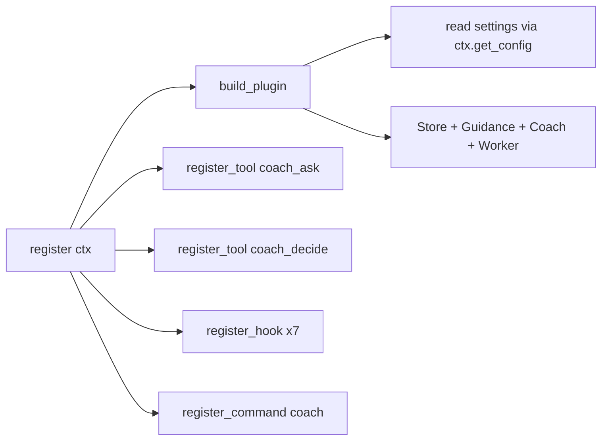
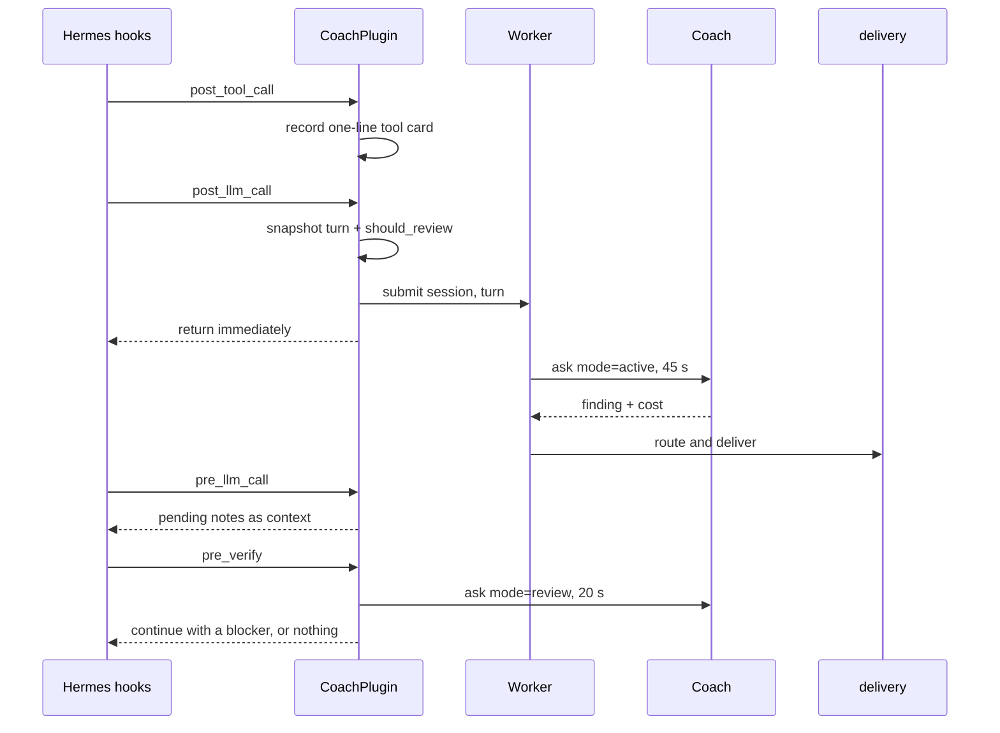

# Plugin runtime

`coach/plugin.py` is the orchestrator: it owns the tools, every hook, the
command surface, the worker, and the decision of when to spend. `coach/worker.py`
is the single background thread that keeps reviews off the turn path, and the
root `__init__.py` is the thin registration seam the host calls.

## Registration

Every registration step is wrapped: a host without `register_tool`, a duplicate
name, or a failed import logs and returns instead of breaking the loader.
Package imports are relative and happen inside `register`, because Hermes loads
the plugin under a synthetic package name.

## Hook flow

| Hook | Job | Failure posture |
|---|---|---|
| `post_tool_call` | Buffer a compact tool card for the current turn | Ignore |
| `post_llm_call` | Snapshot the turn, check cadence/budget/digest, queue a review | Return immediately |
| `pre_llm_call` | Hand over ambient notes once, drop expired ones | Return `None` |
| `pre_verify` | Review the diff and optionally hold completion | Fail open |
| `subagent_start/stop` | Track child sessions so their tools are refused | Ignore |
| `on_session_end` | Prune old session files | Log and continue |

## Review and delivery rules

- **One worker thread, one review in flight, newest queued wins.** A session in
  the queue is tracked under a lock; the key is `(session, turn)`, and a newer
  turn replaces the older queued one.
- **Budget is checked before every automatic call.** `soft` stops Active,
  Review and Decide but leaves explicit consults; `hard` stops all coach calls.
- **The completion gate may hold once per request.** It returns
  `{"action": "continue", "message": …}` only for a parsed blocker, with
  `review_authority="hold_once"` and a free hold slot. Everything else is a card.
- **Holds reload state.** `review_now` saves spend; the hold path reloads before
  writing the hold counter so the spend is not overwritten.
- **Call caps are per turn.** Consult and Decide each count their own calls, and
  the attempt is saved even when the model call fails.
- **Child sessions are refused** unless `allow_in_subagents` is on, so a fan-out
  cannot multiply coach spend silently.
- **The same model is refused.** A coach on the primary model would review its
  own work; `skip_same_model: false` is the only escape.

## Command surface

`/coach` parses `status`, `active|review|decide on|off`, `model [mode]`,
`set key value`, `guidance`, `pending`, `send`, `pause`, and `grant`. Unknown
input prints help; a handler exception becomes a one-line error, never a broken
session.

## Related pages

- [Model access](model-access.md) — what `Coach.ask` and `decide` do.
- [Delivery and evidence](delivery-and-evidence.md) — routing and the diff.
- [Configuration and state](configuration-and-state.md) — what survives a turn.
