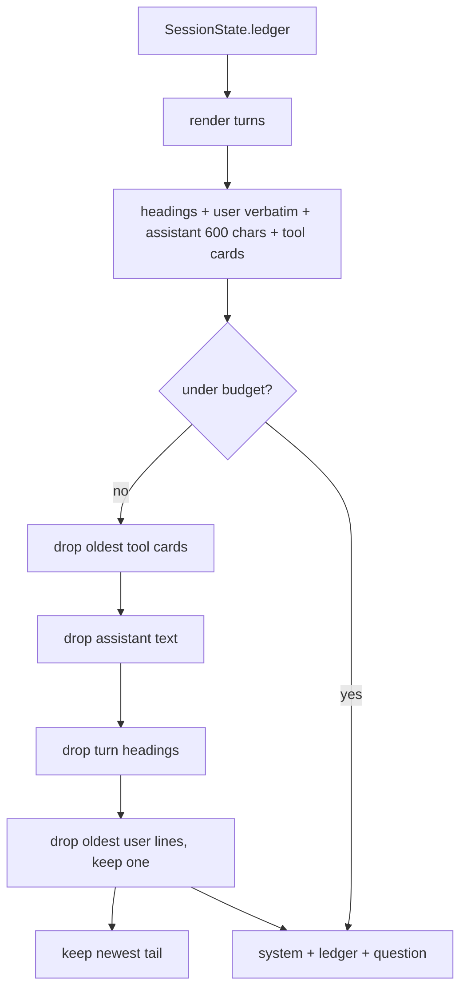
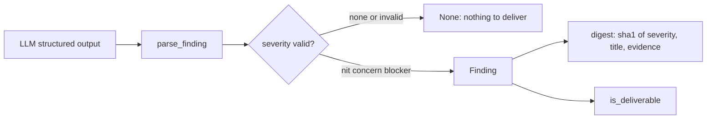

# Prompt assembly: ledger, findings, guidance

Three modules prepare what the coach reads and interpret what it answers. None
of them calls a model.

## Ledger

`append_turn` records one completed turn: user message (capped at 4000 chars),
assistant answer (capped at 600), tool cards, and at most 60 turns. Both caps
apply at write time, so oversized model output never accumulates in memory or
in the session file; pruning also drops per-turn counters whose turn left the
ledger. `build_messages` turns that history into the two or three messages a
call sends.

- The budget is `ledger_max_tokens × 4` characters **minus** the system prompt,
  guidance, session note and question, so the whole prompt fits the ceiling, not
  just the ledger.
- Eviction order preserves intent: tool detail goes first, then assistant
  text, then headings. User messages are dropped only as an absolute last
  resort, oldest first, and never the last remaining one, so the newest context
  always survives; a final line-boundary cut keeps the newest tail.
- Tool cards are one line each: name (≤64 chars), main argument (≤256), status
  (≤64), size, and a truncated preview (`ledger_max_tool_result_chars`).
- Only the newest `ledger_max_recent_turns` turns keep full cards; older ones
  collapse to a count.

## Findings

`Finding` bounds model text at the boundary: title ≤ 80 chars, body ≤ 600.
`SCHEMA` is the JSON schema sent with `complete_structured`
(`additionalProperties: false`). Parsing accepts a dict or a fenced JSON object
inside text, and returns `None` on anything malformed — the plugin never invents
a finding from prose. `digest()` normalises case and whitespace so the same
issue twice is recognised as the same issue.

## Guidance

| Scope | File | Applied |
|---|---|---|
| `project` (also `local`, `cwd`) | `<project>/COACH.md` | That project only; committed with the repo |
| `global` (also `all`, empty) | `$HERMES_HOME/coach/guidance.md` | Every project |

Both are read capped at 4000 chars and wrapped in `<coach-guidance>`.
`system_block` strips opening and closing `coach-guidance` tags inside the files
first, case-insensitively and tolerating inner whitespace: a repo can carry a
`COACH.md`, and text that closes (or reopens) the block would become
free-standing instructions. Only a missing file reads as empty; a permission or
I/O error propagates, and `system_block` degrades to no guidance rather than
failing the turn. Unknown scopes raise rather than silently falling back to
global.

## Reviewer scope

Each system prompt states what its reviewer can see, so a reviewer does not
report its own blind spot as a defect:

| Call | Input | Prompt rule |
|---|---|---|
| Active | Turn ledger: messages and one-line tool cards | "never raise a finding that evidence or a diff is missing" |
| Consult | Question, context, ledger tail | Answer the question; evidence is data |
| Review | Request, claim, this turn's diff, earlier-session commits and the ledger's paths | A missing diff is a coverage limit of the plugin: at most a nit, never a concern; `unverifiable` only for a file the coverage block cannot account for |

The Review prompt also names the session: it says the evidence covers this
turn and, labelled, the paths earlier turns changed, so a multi-turn claim is
not reported as missing work.

## Related pages

- [Configuration and state](configuration-and-state.md) — where the ledger lives.
- [Model access](model-access.md) — the call these messages are sent to.
- [Delivery and evidence](delivery-and-evidence.md) — what happens to a finding.
