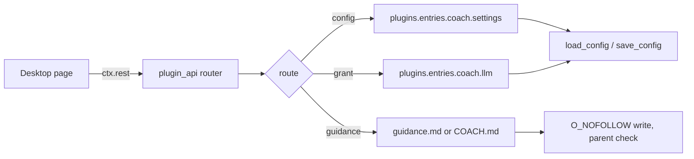

# Settings API

`dashboard/plugin_api.py` is the only backend the Desktop page talks to. It
reads and writes the plugin's config entry, the two guidance files, and the
model-override permission. The module is also importable without a running
gateway through `app_for_tests()`.

## Routes

| Method | Path | Purpose |
|---|---|---|
| `GET` | `/status` | Configured state, resolved models, modes, spend, pending notes, permissions, last error |
| `GET` | `/config` | Current values, defaults, enum choices, permission flags |
| `PUT` | `/config` | Save one or more schema keys; rejects unknown keys and the secret |
| `GET` | `/guidance` | Read one file (`scope=global\|project`, `cwd`) |
| `PUT` | `/guidance` | Replace one file after validating its target |
| `GET` | `/recent` | Newest log findings across up to 20 sessions, optionally filtered by `session`; reads only each file's tail |
| `POST` | `/permissions/grant` | Set `allow_provider_override` and `allow_model_override`, return new status |

## Testability seam

`app_for_tests(home, config)` builds a FastAPI app with `app.state.home` and
`app.state.config` in memory. Every route checks `request.app.state.config`
first, so tests exercise real request/response shapes without touching the
user's `config.yaml`. Production falls through to `_load_host_config()` /
`_save_host_config()`.

## Safety rules encoded here

- **Writes are explicit.** `PUT /config` accepts only keys present in
  `DEFAULTS`, rejects `decide_typesafe_api_key` (Decide keys live in the
  profile environment under `requires_env`, read via the host secret scope),
  and refuses an empty payload. A failed `save_config` is a 500, not a silent no-op.
- **One cap for read and write.** `GUIDANCE_MAX_CHARS` (4 000) bounds both the
  prompt block and the largest accepted save; the route used to accept 8 000 and
  report success for text the prompt never saw.
- **Mutating routes check `Origin`.** A cross-origin request is refused with
  `403 cross_origin_request`; local callers send no foreign origin.
- **Project guidance is scoped.** A project path must already appear in
  `$HERMES_HOME/coach/state.json` under `seen_cwds`, which the plugin writes on
  every turn from `ctx.session_cwd`; the parent is resolved and compared, and
  the file is opened with `O_NOFOLLOW`. A symlink swap between check and write
  fails instead of writing through it. Reads apply the same guard — a planted
  `COACH.md` symlink returns empty rather than the file it points at.
- **Log reads are bounded.** `/recent` reads one trimmed log (≤ 200 lines /
  128 KB), filters by `kind = review` and by session, then takes the newest
  `limit` rows — so a busy other chat cannot displace this one's findings.
- **Log reads are bounded.** `/recent` keeps a `deque(maxlen=limit)` per file
  instead of loading whole logs, so a year of findings cannot turn one page
  refresh into an out-of-memory read.
- **Grant is a real write.** The permission route mutates the config entry and
  surfaces a failed persist; it does not report success it did not achieve.
- **Status is derived, never stored.** Spend and pending counts are summed from
  session files each call, so the page cannot drift from the runtime.

## Related pages

- [Desktop settings page](desktop-settings.md) — the consumer of these routes.
- [Configuration and state](configuration-and-state.md) — the values and files behind them.
